<!-- SPDX-FileCopyrightText: 2026 OpenDot Project <opendotproject.opendot@gmail.com> -->
<!-- SPDX-License-Identifier: Apache-2.0 WITH LLVM-exception -->
# Generic function specialization in FIR and LLVM lowering

## Status and audience

This is an implementation guide for compiler and backend maintainers. The normative source
contract lives in [`spec/GenericFirSpecialization.sol`](../spec/GenericFirSpecialization.sol), and
its case matrix lives in [`spec/GenericFirSpecializationCases.sol`](../spec/GenericFirSpecializationCases.sol).
Those files define the language and conformance obligations. This page describes the current
managed compiler pipeline and where a maintainer should inspect a failure.

The first native specialization slice is intentionally bounded. It admits selected, module-level
generic free functions when all type arguments are closed and every substituted source operation
passes the existing verified FIR checks. It projects already-bound body facts rather than rerunning
full source overload and body analysis for each concrete instance. It does not make every Sol generic
declaration executable. Source-level inference can accept a construct that the native subset still
rejects.

The bounded implementation described here is present in the current feature branch. Its managed FIR
project builds, but this documentation alone does not establish test or CI results, nor does source
compilation establish that every admitted case runs correctly in both AOT and ORC. The feature remains
in active development while those broader acceptance obligations are completed.

This guide assumes familiarity with the compiler's CST, PSI, AST, source analysis, FIR, and LLVM
bridge projects. It focuses on the boundary between a selected generic source call and its concrete
FIR/native function instance. It does not restate the complete generic inference algorithm, source
syntax, package format, or LLVM API wrapper.

## Pipeline at a glance

```mermaid
flowchart LR
    A[AST declarations and calls] --> B[BodyAnalysis]
    B --> C[Selected BodyCallBinding]
    C --> D[FirBuilder reserves ordinary functions]
    D --> E[Generic instance work queue]
    E --> F[Substitute each generic body]
    F --> G[FirFunction and FirCall nodes]
    G --> H[FirVerifier]
    H --> I[FirFlowGraph]
    I --> J[VerifiedFirProgram]
    J --> K[LlvmEmitter]
    K --> L[LLVM C++ API bridge]
    L --> M[AOT object or ORC execution]
```



The pipeline has two separate proofs:

1. Source analysis chooses one callable candidate and records the closed call substitution.
2. The FIR verifier independently checks that the resulting concrete function bodies, calls,
   storage, effects, and control flow meet the native subset.

`BodyBindingStatus.Bound` answers the first question only. It does not mint a `VerifiedFirProgram`
and does not allow LLVM lowering. The backend accepts the verifier's capability object, not an
unverified `FirProgram` or an AST snapshot.

No additional generic IR is introduced. A specialized body is a regular `FirFunction` whose slots,
return type, effects, and expressions have closed `ResolvedType` identities. `FirCall` refers to
that function's numeric ID. LLVM receives the verified, typed FIR nodes and constructs LLVM values
through the C++ API bridge; Solc does not generate LLVM source text and parse it back.

## Relevant code and ownership

| Responsibility | Implementation location | Maintainer question |
|---|---|---|
| Candidate substitution and selected type arguments | `src/managed/OpenDot.Sol.Analysis/BodyBindingBuilder.Calls.cs` | Did the source binder select one candidate and close every declared type parameter? |
| Public body-call fact | `src/managed/OpenDot.Sol.Analysis/BodyAnalysis.cs` | Are declaration-owned arguments kept in declaration order with the call mapping? |
| FIR node metadata | `src/managed/OpenDot.Sol.Fir/FirNodes.cs` | Does each generic call and function retain auditable type arguments? |
| Function enumeration and FIR assembly | `src/managed/OpenDot.Sol.Fir/FirBuilder.cs` | Are ordinary functions reserved before discovered generic instances? |
| Instance key and queue | `src/managed/OpenDot.Sol.Fir/FirBuilder.Specializations.cs` | Is a generic function instance reserved once and bounded? |
| Expression and call lowering | `src/managed/OpenDot.Sol.Fir/FirBuilder.Expressions.cs` | Are expression types closed under the caller's substitution? |
| Array iteration lowering | `src/managed/OpenDot.Sol.Fir/FirBuilder.ForEach.cs` | Are the iterable and item slot specialized consistently? |
| Source-to-FIR proof | `src/managed/OpenDot.Sol.Fir/FirVerifier.cs` | Does the FIR signature match the exact source declaration and selected call? |
| Flow and call-effect graph | `src/managed/OpenDot.Sol.Fir/FirFlowGraph.cs` | Does the graph use the specialized target and its effects? |
| Inspection format | `src/managed/OpenDot.Sol.Fir/FirJson.cs` | Does the schema expose function and call type arguments? |
| LLVM declarations and bodies | `src/managed/OpenDot.Sol.Lowering/LlvmEmitter.cs` | Were all target IDs declared before call bodies are emitted? |

Keep edits with the component that owns the evidence. The source binder owns overload selection and
the type argument list. FIR owns the closed body and its source-origin link. The verifier owns the
independent native-safety proof. LLVM lowering consumes only that proof. Do not recompute overload
resolution in FIR or guess a type argument from the already-substituted parameter list.

## Source binding contract consumed by FIR

`BodyCallBinding` identifies the `AstCall`, selected `AstCallable`, optional receiver, ordered type
arguments, substituted parameter types, substituted result type, argument-to-parameter mappings,
and omitted default parameters. For a nongeneric callable, its type-argument array is empty. For a
generic free function, it has one element for each declaration-owned type parameter, in the exact
order returned by `TypeAnalysis.GetTypeParameters(function)`.

The call binder builds a candidate-local substitution while checking explicit arguments, inferred
evidence, constraints, conversions, effects, and argument mapping. The selected list must be captured
from that final substitution. Recovering it later from a function signature is incorrect: a generic
parameter may not appear in any parameter or result type, and different substitutions can lead to
similar-looking signatures.

The FIR builder trusts the selected source binding only as a selection witness. It still validates
that:

- the target declaration is a source-owned `AstFunction`;
- the target is not an intrinsic adapter or a generic member in this initial slice;
- the number of selected arguments matches the target's declaration-owned parameters;
- each argument is closed after applying the current caller instance's substitution;
- each resulting argument has a native representation supported by `FirVerifier`;
- the target's generic constraints are satisfied for those closed arguments.

If any condition is missing, FIR construction reports a diagnostic and does not create a partially
typed `FirCall`. A rejected or deferred overload candidate never enters the instance queue.

## Specialization identity

Within one `FirBuilder` compilation, a generic function instance is identified by two values:

1. The exact `AstFunction` declaration object selected by source overload resolution.
2. The ordered sequence of closed `ResolvedType` identities selected for that declaration.

The current queue key is represented by the declaration plus a delimited string of type identity
IDs. The type IDs are local to the current analysis workspace. This key is valid only inside that
workspace and is not a persistent cache key, public symbol, mangled ABI name, or cross-build
identifier.

Do not replace the declaration object with the function's display name. Two overloads can share a
name, and the type parameter spelling does not identify its owner. Do not sort the type arguments:
their order is part of the generic declaration contract. Do not use the call-site span as part of
the key: separate source calls with the same selected declaration and substitution reuse one body.

The `FirFunction.SpecializationArguments` array stores the closed ordered arguments for the body.
The `FirCall.TypeArguments` array stores the source-selected call substitution. These fields serve
different purposes:

- Function metadata identifies the type environment used to build and verify one body.
- Call metadata lets the verifier compare the source call, caller environment, and target instance.

An ordinary nongeneric function has an initialized empty specialization array. A generic function
is not emitted as an open function body. Only a call that closes all of its type parameters can
reserve an instance.

### Example

```sol
module docs.generic_specialization_lowering

func <T> identity(value: T): T = value

func mainBody(): () {
    identity(1)
    identity(2)
    identity("two")
}
```

The first two calls resolve to the same declaration and the same `int` type identity. They share
one `identity<int>` FIR body while remaining two distinct `FirCall` nodes with different origins.
The third call has a different key and creates one `identity<String>` body. The source names are
not rewritten; the numeric FIR function IDs distinguish instances in the in-memory program.

If a generic function declares `<A, B>`, then `pair<int, String>` and `pair<String, int>` are
different keys even if their result type happens to match. An unused type parameter is still part
of the key and must have a closed argument selected by source analysis.

## Instance discovery and worklist order

`FirBuilder.Build` first enumerates the ordinary, nongeneric function declarations in source input
order and assigns their IDs. It builds those bodies. When a body contains a selected generic call,
the call is closed under the currently active function substitution, then `SpecializationTarget`
reserves an ID and enqueues a pending instance. Reserving the ID before building the body is what
makes same-key recursion finite.

After ordinary functions have been built, the builder drains the FIFO queue. Each dequeued instance
gets a declaration-owned substitution. Its body is projected into FIR with that substitution. If
that body selects another generic free-function call, the nested target is reserved and appended to
the same queue. The loop ends when no new keys are discovered.

The insertion order is deterministic for a fixed source input ordering because:

- ordinary declarations are enumerated deterministically;
- each FIR body is traversed in source order;
- type arguments remain in declaration order;
- a previously reserved key returns its original ID without adding a duplicate queue entry;
- final functions are emitted in their assigned ID order.

The current guarantee is scoped to one fixed input enumeration and one analysis workspace. It does
not guarantee stable numeric IDs after source files are reordered, compiler versions change, or the
type interner changes. Persistent caches must define a separate canonical serialization instead of
storing these transient IDs.

### Simplified control flow

```text
reserve every nongeneric function and assign its ID
build each nongeneric body in declaration order

while the pending instance queue has a next item:
    set the current declaration and ordered substitution
    build its concrete body as ordinary FIR nodes
    each selected nested generic call:
        substitute the caller's arguments into the callee's ordered arguments
        validate the closed type tuple and constraints
        reserve or reuse the callee key
        emit a FirCall to the reserved target ID

order functions by ID
verify the whole closed FIR program
```

This is a reachability-driven body build, not a whole-project instantiation sweep. An unused generic
definition does not create a machine body merely because it appears in a file. A selected generic
call in an ordinary entry or helper body seeds the queue. Calls in a specialized generic body add
the transitive generic targets needed by that instance.

The queue is compilation-local. It must not be shared across concurrent `FirCompilation` calls, and
it must observe the compilation cancellation token while dequeuing and while substituting types.

## Substituting a generic body

`BodyAnalysis` records declaration-level expression facts. For a generic declaration, some of those
facts contain the declaration's open type parameters. The FIR builder does not copy an existing
FIR body because a generic declaration has no source-independent verified body to clone. Instead,
it reads the source-owned AST and body facts again while applying the instance substitution.

For the current instance, the substitution maps each type-parameter identity returned by
`TypeAnalysis.GetTypeParameters(function)` to the matching closed argument. Substitution is
simultaneous and uses the analysis workspace's `TypeSpecialization` interner. It is applied to:

- the function's declared parameter types;
- the body summary result type;
- declared effect types;
- expression binding types when creating constants, reads, calls, and operators;
- explicit local binding types;
- array item types and other body constructs that carry resolved source types;
- nested selected-call type arguments before the callee key is created.

Local variables inferred from their initializer use the already-specialized FIR expression type.
Lexical locals continue to use the source `LocalSymbol` identity, while each newly built function
gets a fresh FIR slot map. Slot IDs start at zero for that function and follow the builder's source
walk. The specialization must not share mutable slot identities between two function bodies.

The builder should report a bounded resource diagnostic if a type substitution exceeds the
workspace's allowed construction depth or instance budget. It should not retain an open parameter
as a fallback type. Returning the original open type after a substitution error is only an internal
recovery value; any such diagnostic prevents the `FirCompilation` from producing a verified
program.

### Nested substitution example

```sol
module docs.generic_specialization_lowering

func <T> identity(value: T): T = value
func <T> relay(value: T): T = identity(value)
```

The source binding for `identity(value)` inside `relay` has an argument that is the open parameter
owned by `relay`. The declaration-level binding may therefore record `identity<T>` at that AST
site. When the builder creates `relay<int>`, it substitutes the outer `T` with `int` before asking
for the target identity. The queue creates or reuses `identity<int>`, and the emitted `FirCall` has
target ID for that instance and type arguments `[int]`.

It is not sufficient to close only the `FirCall.Type`. The target ID, call metadata, expression
type, parameter type, return type, local slot types, effects, and nested calls must all describe the
same closed environment. The verifier is intended to make mismatches observable.

## Admission boundary and resource limits

Specialization admission happens after a source call has selected one candidate. It does not affect
candidate ranking. A non-generic overload must not win simply because a generic candidate's native
body is unsupported; the source binder chooses according to language rules, then the native
pipeline reports the selected body's unsupported feature.

The current native admission boundary is:

- the target is a module-level `AstFunction` with a body;
- every generic type argument is closed and belongs to the same specialization workspace;
- every type argument fits the existing `FirVerifier.Supported` source ABI subset;
- no argument contains a generic parameter or a ref-like type;
- declaration constraints are proven satisfied;
- the body uses only source shapes represented by verified FIR;
- every transitive selected call also has an ordinary function target or an admitted generic
  instance.

`FirBuilder.Specializations.cs` currently places hard caps on the native instance graph: 4,096
distinct generic function instances, 16,000,000 source-body AST nodes accounted across those
instances, and 128 levels of type structure in an instance argument per compilation. Exceeding a cap
is a compilation error, not permission to truncate the queue. The workspace's own type-substitution
depth and interned-type limits remain separate budgets. Do not report a type interner budget as if it
were the native instance-count budget.

The breadth of the queue is bounded by unique keys. A recursive call with the exact same key reuses
the reserved function ID. Recursion that continually grows its type arguments must eventually hit a
type-shape or resource boundary. Neither case is permitted to recurse indefinitely in the builder.

The 128-level argument-depth check is meaningful only when the candidate representation permits
that nesting. Current FIR admission rejects nested arrays and most constructed types before they
can reach LLVM. If representation support expands, retain the depth guard and test an actual
type-growing recursion path.

## Current verified source and ABI subset

Generic substitution does not expand the native type system. It admits only types already
understood by the verified FIR and LLVM emitter. `FirVerifier.Supported` is the first source of
truth for the FIR subset; `LlvmEmitter.Type` and the runtime ABI define the concrete target ABI.
Keep both sides aligned when adding another representation.

| Closed source type | Current native representation | Notes |
|---|---|---|
| `bool` | `i1` | Boolean operators and control-flow conditions are verified separately. |
| `sbyte`, `byte` | `i8` | `byte` is unsigned in literal range and arithmetic handling. |
| `short` | `i16` | Narrow integer operations use the existing extension/truncation rules. |
| `int`, `uint` | `i32` | Signed and unsigned behavior remains encoded in the source type. |
| `long`, `ulong` | `i64` | Signed and unsigned behavior remains encoded in the source type. |
| `single` | LLVM `float` | Non-finite and out-of-range literal values are rejected by FIR checks. |
| `double` | LLVM `double` | Non-finite literals are rejected by FIR checks. |
| `std.core.String` | managed reference (`ptr`) | Calls use the existing runtime object/string ABI. |
| one-dimensional `[]T` | managed reference (`ptr`) | `T` must be a supported primitive or `String`. |
| empty tuple `()` | `void` result | It is not a storable local or parameter value. |

`half` and `quad` are built-in source types, but are outside the current native subset. Nullable
values, fixed arrays, tuples with elements, function values, ref-like types, arbitrary nominal
types, nested arrays, and arrays of unsupported element types are also outside this generic FIR
slice. A source declaration can still be parsed or type-checked without being accepted for this
backend.

The table is not a blanket ABI promise for all contexts. A supported type must still appear in a
legal function parameter, return, local, array, operation, effect, and runtime call context. For
example, unit is a result but not a slot type. Ref and out parameters use pointer ABI slots and
still need exact writable local storage and control-flow proof.

The ordinary LLVM emitter declares all non-runtime FIR functions before emitting their bodies.
Therefore a generic call can refer to a later queue entry, a mutual recursion target, or the same
function ID without requiring declaration order to mirror call order. Its target symbol is the
compiler-private `sol_fn_<id>` form. That symbol is not a stable external ABI name.

## Independent FIR verification

The builder creates candidate FIR and diagnostics. Only `FirVerifier.Verify` can create
`VerifiedFirProgram`. For a generic function instance, the verifier needs to check the specialization
metadata against the source declaration before accepting any body nodes.

The source contract checks include:

- the FIR function origin identifies exactly one source function declaration;
- `SpecializationArguments` has the same arity and order as that declaration's type parameters;
- each argument belongs to the current type workspace, is closed, and is supported by the native
  subset;
- no two emitted function records claim the same declaration and ordered type tuple;
- the declaration's generic constraints remain satisfied;
- substituting the source body summary result yields the FIR result type;
- substituting source parameter and effect types yields the FIR signature and effect set;
- each parameter retains its name, passing mode, and source origin relationship.

For each `FirCall`, verification connects three facts: the original `BodyCallBinding`, the call's
type-argument list after applying the caller function's substitution, and the target
`FirFunction.SpecializationArguments`. The selected source declaration must match the target's
source origin. The call result must match both the specialized source binding and target function
result. Each argument must point to the original source argument expression, have the mapped
parameter index and passing mode, and exactly match the target slot type.

This is intentionally redundant with construction. The builder is not a trusted verifier, and a
tampered FIR record must not become codegen input merely because it once came from `FirBuilder`.

The verifier also checks the existing native invariants: literal bounds, slot identity and
mutability, storage representability, supported operations, checked effects, array element types,
entry shape, no uninitialized reads, and complete control-flow behavior. Generic substitution must
not weaken any of those rules.

`FirFlowGraph` is a side table over verified FIR, not another value-level IR. Its call sites point
to the specialized numeric function target and carry the target's specialized effect list. The
flow graph verifier remains responsible for assignment and out-parameter guarantees after
specialization.

## FIR inspection schema

The FIR inspection JSON schema records specialization arguments on each function and call. The
schema version changes when these fields become part of the serialized contract. Consumers should
read the `schema` field and reject unsupported versions rather than silently ignoring unknown
identity metadata.

The function record includes its numeric ID, source name, runtime adapter kind, ordered
`specializationArguments`, result type ID, effects, parameter and slot information, and body. A call
node includes its target ID, ordered `typeArguments`, and parameter-mapped source expressions. The
type table resolves each type ID within the serialized FIR document.

FIR JSON is useful for diagnostics, regression assertions, and comparing verifier inputs. It is not
a stable cache format, object-file format, or public ABI. It may expose workspace-local type IDs
whose numbering changes when analysis inputs change.

When inspecting a generic call, compare the following together:

1. the generic function's `specializationArguments`;
2. the call's `typeArguments`;
3. the target function ID;
4. the target function's closed parameter and result type IDs;
5. the call expression's result type ID;
6. its source origin and flow-graph call target.

A mismatch among these values indicates an incomplete builder substitution or a missing verifier
check. Do not fix an inspection snapshot by removing the type arguments field.

## LLVM lowering and runtime interaction

`LlvmEmitter.Build` receives only `VerifiedFirProgram`. It declares runtime helpers, declares every
ordinary and specialized `FirFunction` using the existing closed `Type(ResolvedType)` mapping, then
emits each function body. A `FirCall` indexes the program's function table and invokes the matching
`sol_fn_<id>` declaration. Generic parameters do not appear in LLVM types or symbol names after FIR
verification.

The generic body uses the same lowering paths as a handwritten nongeneric body after substitution:

- integer and floating operations use the established typed arithmetic helpers;
- local values use the per-function FIR slots;
- `String` and managed arrays use pointer ABI values and the existing runtime entry points;
- array access uses the existing bounds and element-kind checks;
- GC root maps and safepoints are computed from concrete FIR types;
- call evaluation order and argument mapping remain those selected in source analysis.

No generic runtime dispatcher is generated. There is no runtime dictionary, hidden type descriptor,
type-argument object, reflection lookup, or late JIT specialization request. The full body graph is
closed before either AOT code emission or ORC execution starts.

For `bin` AOT, each specialized function is part of the same module being verified and emitted.
For ORC, the same verified FIR and LLVM module shape are used before the existing separate-process
execution boundary. The fact that both backends consume generic FIR does not enable generic methods,
dynamic dispatch, or generic cross-library imports.

`staticlib`, `cdylib`, and `solib` retain their independent export and packaging contracts. A
specialized generic function is an internal implementation function, not an implicit C export. The
current `.solib` surface does not promise precompiled generic instances for unknown downstream type
arguments.

## Diagnostic interpretation

| Diagnostic | Meaning at this boundary | Appropriate investigation |
|---|---|---|
| `SOL2400` | A source construct or selected specialization shape lies outside verified native FIR. | Check the exact source origin, selected candidate, owner kind, argument representation, and body operation. |
| `SOL2401` | Executable entry selection does not satisfy `Main.main(args: []String): ()`. | Check the entry declaration independently of the generic call graph. |
| `SOL2403` | Generic instance count, specialized body-node, type-depth, or FIR-time type-interner resource limit was reached. | Check the specific cap and source call; do not truncate the instance graph. |
| `SOL2402` | Independent FIR verification found a source, signature, effect, type, or call-identity mismatch. | Inspect the verifier invariant and the malformed/generated FIR metadata. |
| source-analysis diagnostic | The candidate was invalid, ambiguous, deferred, inaccessible, or failed a language rule before FIR. | Fix source binding; do not adjust native target selection to bypass it. |
| verifier diagnostic | Constructed FIR did not independently satisfy the source, type, storage, effect, or flow contract. | Inspect the FIR node and source origin; repair the producer or verifier proof, not LLVM text. |
| LLVM bridge failure | Verified FIR could not be represented or LLVM rejected the API-built module. | Confirm the verifier admitted the exact operation and compare bridge operation arguments. |

`SOL2400` is not a generic inference error. A source call can be semantically valid while the selected
generic body's native representation is unsupported. Conversely, an unsupported generic candidate
must not be skipped to select a worse-ranked nongeneric overload. Preserve the distinction between
source correctness and backend admission in diagnostics and test names.

`SOL2403` must report a deterministic limit boundary. Do not catch it and emit an empty function,
truncate work, or downgrade it to a warning. A failed specialization makes any caller requiring
that target unavailable for native emission.

## Areas not covered by this first slice

The following remain separate compiler projects and must not be inferred from free-function
specialization:

- generic class, struct, ref-struct, object, interface, enum, constructor, property, accessor, and
  operator specialization;
- generic receiver layout, vtables, virtual dispatch, interface dispatch, or constructed-base
  member code generation;
- generic function values, delegates, lambdas, closure conversion, and runtime type parameters;
- generic public C exports, generic `.solib` ABI, cross-module cache identity, and precompiled
  downstream instances;
- nullable, fixed-array, tuple, arbitrary nominal, ref-like, half, quad, nested-array, or otherwise
  unsupported native value layouts;
- type-argument-driven reflection, runtime dictionaries, reified metadata, or dynamic code loading;
- unimplemented source body forms such as unsupported defaults, varargs, member storage, cleanup,
  exception propagation, and operations not represented by verified FIR;
- generic effect-set inference patterns that source analysis still defers;
- a persistent cross-build specialization cache or stable symbol mangling scheme.

When adding one of these, define its source typing, lifetime and layout, verifier invariants, GC
root behavior, ABI and artifact rules first. A successful `TypeSpecialization.Substitute` call by
itself is not enough to authorize native storage or calling convention.

## Review checklist for changes

### Source binding

- Does `BodyCallBinding` retain ordered declaration-owned type arguments, including explicitly
  written arguments and inferred arguments?
- Does it keep `[]` for a nongeneric target rather than a default/uninitialized array?
- Are result, parameter, effect, and argument mappings derived from the same final substitution?
- Does source overload ranking remain independent of FIR support?
- Can a deferred candidate still affect the unique winner?

### Worklist construction

- Are ordinary target IDs fixed before generic instances are reserved?
- Is the key declaration identity plus an ordered closed type tuple?
- Is the key compilation-local and free of host paths or usernames?
- Is the ID reserved before adding the pending body, so exact recursion reuses it?
- Are nested selected generic calls substituted in the active caller environment?
- Does cancellation reach queue processing, recursive traversal, and type substitution?
- Does every hard limit fail the whole dependent compilation without truncating work?

### Body and verifier

- Are expression types, local slots, parameters, results, effects, and array item types all closed?
- Does each specialized body retain the original source declaration origin?
- Do call type arguments agree with the source binding after caller substitution?
- Does the target function carry the same type tuple as the call?
- Are constraints checked again by the verifier?
- Are call arguments exact in both type and passing mode?
- Do CFG call effects and out writes use the specialized target's signature?
- Are duplicate keys and open parameters rejected?

### LLVM and artifacts

- Is all target declaration work complete before any `FirCall` body is emitted?
- Does each specialized type map to a supported ABI representation?
- Are `String`/array roots and safepoints preserved for the closed type?
- Does LLVM module verification run after constructing the API module?
- Are generic internal functions kept out of public C exports?
- Do package metadata, AOT, ORC, and library paths agree on the supported contract?

## Debugging workflow

When a generic call fails during native compilation, follow this order:

1. Confirm the syntax and AST represent the intended explicit or inferred type argument list.
2. Inspect source analysis diagnostics and the `BodyCallBinding` for the exact call origin.
3. Confirm candidate selection is unique and the chosen substitution is complete.
4. Check whether the call target is a module-level function or a generic member outside this slice.
5. Compare the type arguments with the supported source-to-ABI table.
6. Inspect the queue key and determine whether the instance is new or reuses a reserved ID.
7. Inspect the specialized function's parameters, result, effects, locals, and expression types.
8. Run the independent verifier and find the first source-origin diagnostic.
9. Only if verified FIR exists, inspect the `LoweringTrace` or bridge operation failure.
10. Confirm the artifact path uses the intended verified program and backend.

Do not start by changing `LlvmEmitter.Type` when the problem is an open type parameter in FIR. Do
not broaden `FirVerifier.Supported` just to silence a build error. Add a type representation only
with its ABI, GC/root, literal, operation, runtime, and artifact evidence.

## Typical failure traces

These traces help distinguish a source-binding failure from a native-admission failure. They are
descriptions of the compiler stages, not claims that every source example is currently accepted.

### Two calls reuse one instance

For two direct calls `identity(1)` and `identity(2)`:

1. Source analysis selects the same `AstFunction` declaration twice.
2. Both `BodyCallBinding` values contain the ordered argument tuple `[int]`.
3. The first FIR call reserves an instance key and assigns its target ID.
4. The second lookup finds the key and reuses the ID.
5. The pending queue contains one body; the FIR tree contains two calls with distinct origins.
6. The verifier checks both calls against the same specialized signature.
7. LLVM declares one private `sol_fn_<id>` and emits two call instructions.

If two bodies appear, compare `AstFunction` identity and the `ResolvedType` identities. If no body
appears, check whether the selected source calls actually reached `FirBuilder` and whether a
diagnostic stopped the compilation before verification.

### A nested call uses an open parameter in source analysis

For `relay<T>(x: T) = identity(x)`, the body binding for `identity(x)` may refer to `relay`'s open
`T`. That is expected at the declaration-analysis stage. It is not valid as a final native
argument. When building `relay<String>`, the builder must first substitute the outer `T`, then look
up or enqueue `identity<String>`. A `FirCall` whose target is `identity` but whose argument remains
`T` indicates the caller substitution was skipped.

If the nested instance has two separate IDs for `identity<String>`, inspect the key encoder. It
must see the same declaration object and the same interned closed type identity in both paths.
Recreating an equivalent but foreign type in a second workspace is an ownership bug, not a reason to
weaken identity checks.

### The source call is valid but its ABI is unsupported

Suppose source inference selects a generic identity call with a `half` argument. Source binding can
retain that selection. The native FIR boundary must reject the selected specialization because
`half` has no current lowering in `LlvmEmitter.Type`. The compiler should identify the selected
call or source type, produce no `VerifiedFirProgram`, and avoid asking LLVM to invent a fallback.

Do not re-run overload selection with backend-specific candidates. If the source overload is
semantically unique, a native limitation is a backend diagnostic. If a different source overload
is actually better, source analysis must select it before FIR starts.

### Generic member versus free-function specialization

`func <T> identity(value: T): T` at module scope can be a candidate for this first slice. A generic
method on a class or object is outside the scope even if its method-owned parameter appears closed.
The method may depend on a generic owner, receiver layout, dispatch rule, constructor invariant, or
visibility path that the free-function worklist does not model. Reject it at the call boundary with
the existing native-subset diagnostic. Do not silently erase the receiver or map it to a free
function with a similar name.

### The call agrees but the verifier rejects the body

When a `FirCall`'s type argument and target agree, a failed verifier can still be correct. The body
may contain a local `T` that was not substituted, a return branch that does not satisfy definite
assignment, an unsupported nullable operation, an incorrect effect set, or an array item whose
source element type differs from the slot. Find the first diagnostic's source origin, inspect the
closed function body, and determine which producer fact disagrees. A matching function name alone
is not a verifier proof.

## Compilation cost and queue behavior

The native cost grows with the number of unique admitted keys, not the number of source call sites.
Repeated calls with one key add call nodes but do not add another body. Calls with different closed
arguments add another body each. A generic helper called with many concrete scalar types can
therefore produce many LLVM functions even when the source declaration is short.

Current caps are safeguards for compilation resources, not user-visible generic semantics. A
program that reaches the instance limit has not been partially compiled. The requested native
artifact must fail as a whole because dropping a target would change behavior. If a later design
introduces incremental output, it needs an explicit artifact transaction that prevents publishing
part of the graph.

Avoid unbounded work before the key check. Compute a closed type tuple once, check whether its key
already exists, and only then allocate a function ID or queue item. Validate type shape and
constraints before committing the reservation when those checks can fail without mutating the
worklist. If any later body step fails, the overall compilation still fails, so no artifact may
observe an incomplete queue entry.

Queue ordering is also a reproducibility concern. Use deterministic declaration and body traversal;
do not use concurrent dictionary iteration or hash-set enumeration to assign IDs. If parallel body
construction is introduced, reserve keys and IDs through a deterministic discovery phase, or make
the serialized/native naming scheme independent of work scheduling.

Cancellation is checked while ordinary and specialized functions are built and while type
substitution runs. Long-running member projection or constraint checks must continue to observe the
same token. Cancellation must not be converted into `SOL2400`, `SOL2402`, or `SOL2403`; the caller
requested that the compilation stop, and cancellation is not evidence that a source program is invalid.

## Extending native type support safely

Adding a source type to the specialization admission table is not a one-line change. For every new
type category, a maintainer should answer each of the following before enabling it:

1. What is its canonical `ResolvedType` identity and how does substitution reconstruct it?
2. Can it appear in parameters, results, locals, fields, arrays, tuples, or only some positions?
3. What exact LLVM type and calling convention represent the value?
4. Does the value own or reference memory managed by Yellow Tea?
5. Which object fields or array elements must appear in precise GC maps?
6. What safepoints can occur while constructing, returning, storing, or copying it?
7. Which literal, arithmetic, comparison, nullability, conversion, and equality operations exist?
8. Which runtime functions consume or produce it, and what are their versioned ABI contracts?
9. How does the verifier reject forged or malformed FIR for that type?
10. Does every artifact kind preserve the same representation or have a separate export rule?
11. How does an unsupported type produce a stable source-origin diagnostic?
12. Which source examples and verifier-negative cases establish the admitted boundary?

For example, `std.collections.Vector<T>` cannot be admitted just because `T` is a supported
primitive. The type has a nominal owner, allocation and mutation behavior, a layout, runtime
methods, and possibly GC-bearing storage. It needs its own source/type layout contract and verified
lowering. The same caution applies to user-defined classes and ref-like values.

The safest extension is one representation at a time. Add the type identity and source-level rules,
then verifier checks, then managed runtime semantics, then LLVM ABI, and finally the artifact/export
surface. Keep generic specialization admission as a consumer of those completed lowerings; do not
make it the path that defines the lowering implicitly.

## Maintenance and compatibility

Changes to `FirCall.TypeArguments`, `FirFunction.SpecializationArguments`, or their JSON fields are
inspection-schema changes. Bump the schema when the serialized contract changes and update all
consumers in the same PR. The in-memory records are internal verification evidence, so constructor
defaults must remain safe for ordinary nongeneric functions while generic instances demand
explicitly initialized, non-open metadata.

When changing the key representation, preserve equality over the exact source declaration object
and ordered type identities for one compilation. When adding persistent cache support, define a
canonical stable declaration identity, type serialization, compiler version key, target triple,
runtime ABI, feature configuration, and source-origin mapping. Workspace type IDs must not be
persisted or compared across compilation sessions.

Keep this guide factual as the implementation evolves. If the implementation adds a feature listed
above as unsupported, update the normative `.sol` contract, conformance fixtures, verifier, backend
ABI, and this guide together. If implementation changes are still pending CI, describe them as
pending rather than claiming the released compiler supports them.
